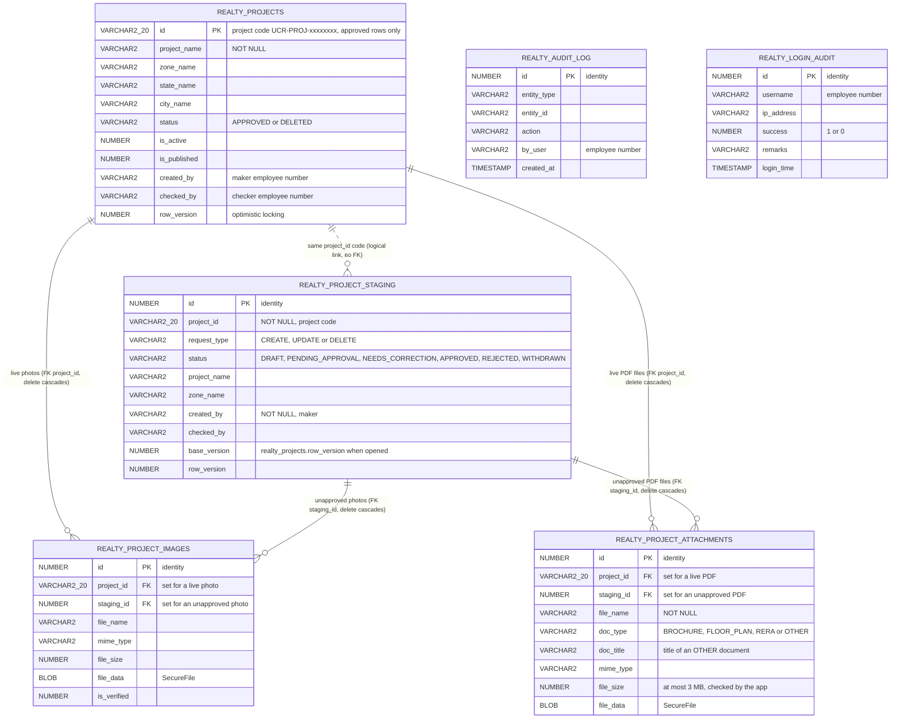

# ER diagram: the tables UCO Realty uses

Source of truth: `db_migrations/01_CREATE_TABLES.sql` (the same statements without comments are in `01_CREATE_TABLES_AND_INDEXES_CLEAN.sql`). Only the key columns are drawn; the project tables have about 60 columns each (see the script).

## Reading the diagram
* **Master and staging:** `realty_projects` holds approved projects only. Everything a maker is working on (new, edit, unit reduction, deletion) is a row in `realty_project_staging` until a checker approves it; the approval then applies it to `realty_projects`. `project_id` in staging is the same code as `realty_projects.id`, but there is no foreign key (a new project does not exist in the master yet). One open request per project is enforced by the unique index `ux_realty_staging_one_open`.
* **Photos and PDF files:** a file belongs either to a live project (`project_id`) or to a maker's unapproved work (`staging_id`), never both (check constraints `chk_realty_image_owner`, `chk_realty_att_owner`). Deleting the project or the staging row deletes its files.
* **Document slots:** `doc_type` says which named slot a PDF fills (Brochure, Floor Plan, RERA Certificate; one per project, a new one replaces the old) or `OTHER` (any number, each with the maker's `doc_title`). Constraint `chk_realty_att_doctype`.
* **Audit tables** stand alone: they hold the employee number as text, with no foreign key.

## Tables we only read (owned by the bank, not created by us)
| Table | Used for |
| :--- | :--- |
| `HRMS_DBA.employee_contact_details` | employee name, posting SOL, scale, cadre, retired flag (sign-in and role) |
| `HRMS_DBA.employee_tenure` | current posting (wins over the contact row) |
| `HRMS_DBA.LG_ENTRY_REVAMP` | customer leads saved by the Home Loan page (`CHANNEL = 'REALTY'`) |

The application user only has `SELECT` on these. They are linked to our tables only by the employee number kept as text in `created_by`, `checked_by`, `by_user` and `username`.

## Indexes (15)
| Table | Indexes |
| :--- | :--- |
| `realty_projects` | `idx_realty_proj_status_pub` (status, is_active, is_published), `idx_realty_proj_zone`, `idx_realty_proj_branch`, `idx_realty_proj_geo` (state, city) |
| `realty_project_staging` | `idx_realty_staging_project` (project_id, status), `idx_realty_staging_status` (status, request_type), unique `ux_realty_staging_one_open` |
| `realty_project_images` | `idx_realty_proj_img_pid`, `idx_realty_img_staging` |
| `realty_project_attachments` | `idx_realty_att_project`, `idx_realty_att_staging` |
| `realty_audit_log` | `idx_realty_audit_entity` (entity_type, entity_id), `idx_realty_audit_created` |
| `realty_login_audit` | `idx_realty_login_audit_time`, `idx_realty_login_audit_user` |
